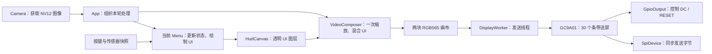

# 代码阅读指南

先读 `src/app.cpp` 的 `App::run()`：它是整个程序的流程目录。再沿着一次调用进入菜单、合成器或显示线程，不必一开始读完所有驱动。

## 命名空间与注释约定

业务代码统一使用 `autoaimer` 命名空间，例如 `autoaimer::App`、`autoaimer::VideoComposer`。测试适配器使用 `autoaimer::test`，性能分析辅助代码使用 `autoaimer::profile`。`.cpp` 内的匿名命名空间只隐藏当前文件的内部实现。

类和方法的用途集中写在头文件声明处，采用下面的格式；复杂参数约束、线程归属和生命周期可补在“说明”字段中。实现文件继续保留算法步骤和同步原因，不重复整段接口注释。

```cpp
/**
 * 类名称：DisplayWorker
 * 类作用：管理发送线程和双缓冲归属，优先发送最新完整画面。
 */
class DisplayWorker {
public:
    /**
     * 方法名称：DisplayWorker::submit
     * 方法作用：提交已写完整的画布，并通知发送线程。
     */
    bool submit(unsigned buffer, std::string& error);
};
```

## 一帧画面经过哪里



主线程处理图像、输入和菜单；另一个线程只负责送屏。`DisplayWorker` 负责交接两块画布的使用权，让主线程在发送期间继续合成。

## 各模块负责什么

| 入口 | 责任 |
|---|---|
| `src/main.cpp` | 解析启动参数、安装退出信号处理、创建硬件/空接口，启动 `App`。 |
| `src/app.cpp` | 把每帧的获取、菜单更新、绘制、合成、提交串起来；在绘制后切换菜单。 |
| `src/ui/menus/` | 每个页面独立 `.h/.cpp`。`update()` 处理输入与状态，`render()` 绘制 UI。 |
| `src/ui/menu_stack.cpp` | 管理页面压栈、返回；只有栈顶页面参与本帧处理。 |
| `src/ui/hud.cpp` | 提供点、线、圆和文字绘制；当前字库仍是内嵌的 5×7 点阵。 |
| `src/compute/trajectory.cpp` | 轨迹计算、投影和近面裁剪；不操作界面或硬件。 |
| `src/input/`、`src/sensors/` | 按键、IMU、测距接口，以及读数状态和采样时间。 |
| `src/media/camera_*.cpp` | 两种相机来源：无摄像头时生成 NV12 图像；真实相机使用 SDK VI/ISP。 |
| `src/media/video.cpp`、`video_rga.cpp` | 一次居中裁剪/缩放，叠加 UI，写入选定的 RGB565 画布；RGA 路径复用 SDK。 |
| `src/media/display_worker.cpp` | 用 `std::thread` 发送完整画面，管理双缓冲归属与错误回传。 |
| `src/media/display_gc9a01.cpp` | 解释面板协议，控制 DC/复位时序，将最终画布打包为 30 个裁剪条带。 |
| `src/io/spi.h`、`spi_linux.cpp` | 通用 SPI 字节写入接口，以及 Linux spidev 配置、写入与句柄管理。 |
| `src/io/gpio.h`、`gpio_linux.cpp` | 通用 GPIO 电平接口，以及按 bank 标签查找和申请引脚的 Linux 实现。 |

## SPI 为什么不需要知道屏幕

`Gc9a01Display` 决定发送什么，以及何时改变 DC 和 RESET。它通过 `writeCommand()` 先把 DC 拉低、写命令字节，有数据时再把 DC 拉高、写完整数据块。`SpiDevice` 只接收指针与字节数，不解释命令、色彩或像素；`GpioOutput` 只设置物理电平，不决定引脚的用途。

`main.cpp` 创建 `LinuxSpiDevice` 和两个 `LinuxGpioOutput`，填入标准 Pico 的设备路径和引脚映射，再把它们借给屏幕对象。对象按相反顺序销毁，因此显示线程先结束，最后才释放硬件句柄。GPIO 仍使用字符设备接口，按 `gpio1` 标签定位，不能假定它一定叫 `gpiochip1`。

SPI 接口保持同步，调用返回后才允许复用发送数据。异步交接仍只有 `DisplayWorker` 这一处，不在 SPI 层再加队列或锁。每帧仍为 30 个窗口、180 次 SPI 写入、180 次 DC 设置，共 93,770 字节；条带打包缓冲固定复用。

初始化延时可注入回调：正式运行使用标准库等待，单元测试记录等待次序而不实际休眠。初始化参数统一注明厂家来源；有手册说明的命令标注功能及页码，资料不一致之处单独说明，保持已验证的字节。

## 双缓冲只记住三条规则

1. **正在发送的画布不能写。** `sendingBuffer` 表示发送线程当前借用哪一块。
2. **尚未发送的旧画面可以替换。** `readyBuffer` 表示最新完整待发送帧；主线程可以收回它来合成更新画面，不积压帧队列。
3. **交接时加锁，画图和发送时不持锁。** 两块像素内存一直由 `VideoComposer` 持有，线程间只传索引和视图，不复制整帧。

两个索引的取值为 `0`、`1`，`-1` 表示没有对应画布。主线程按 `acquire → compose → submit` 使用接口。只有 `submit` 之后，发送线程才能读取新画面；如果另一块正在合成，发送线程等待完整帧。

退出时，`finish()` 发出停止请求、送完最后一张已提交的完整帧，再等待线程退出（`join`）。之后才能销毁画布和硬件接口。SPI 失败会保存错误，由主线程读取并退出。

## 菜单和硬件怎么分开

主界面 `ViewMenu` 根据有效传感器数据更新曲线、落点和水平仪；确认键返回“测一次距离”的动作，由 `App` 调用测距接口。菜单不直接写 GPIO 或访问相机。

`SettingsMenu` 选择下一页；`ParameterMenu` 先修改本页草稿，确认才写回配置；`CalibrationMenu` 当前只是入口和占位提示，尚未实现标定求解。

正式程序目前创建 `NullButtonInput`、`NullImuSensor` 和 `NullDistanceSensor`，明确表示硬件尚未接入。假按键和假传感器数据放在 `tests/`；无摄像头图像由独立的 `camera_sim.cpp` 提供。

## 构建与阅读顺序

`CMakeLists.txt` 有两个独立开关：

| 开关 | ON | OFF |
|---|---|---|
| `AUTOAIMER_BOARD` | SDK 真实相机与 RGA | 合成 NV12 图像与 CPU 合成 |
| `AUTOAIMER_SPI_DISPLAY` | GC9A01 SPI 屏幕 | 空显示接口，可导出 PPM |

当前板上的无摄像头版本使用 **OFF / ON**。主机验证通常使用 **OFF / OFF**。CMake 根据这两个开关挑选实现文件，主循环使用相同的接口。

建议顺序：`main.cpp` → `app.cpp` → `ui/menus/view_menu.cpp` → `media/video.cpp` → `media/display_worker.cpp`。需要接硬件时再进入具体驱动。目录和类名保持原样，后续排版统一使用项目内的 `.clang-format`。
